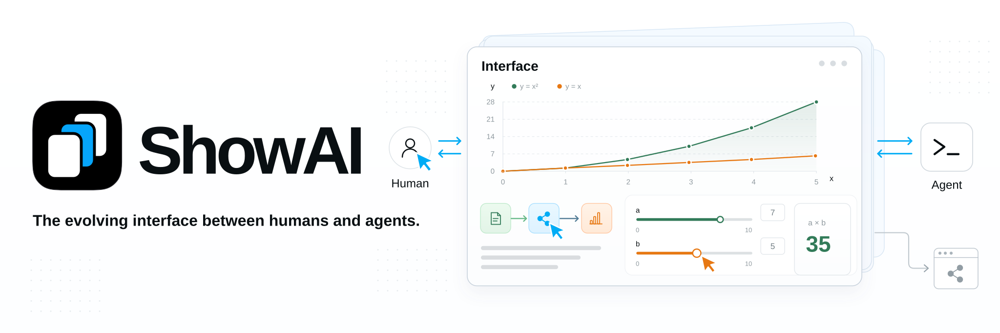
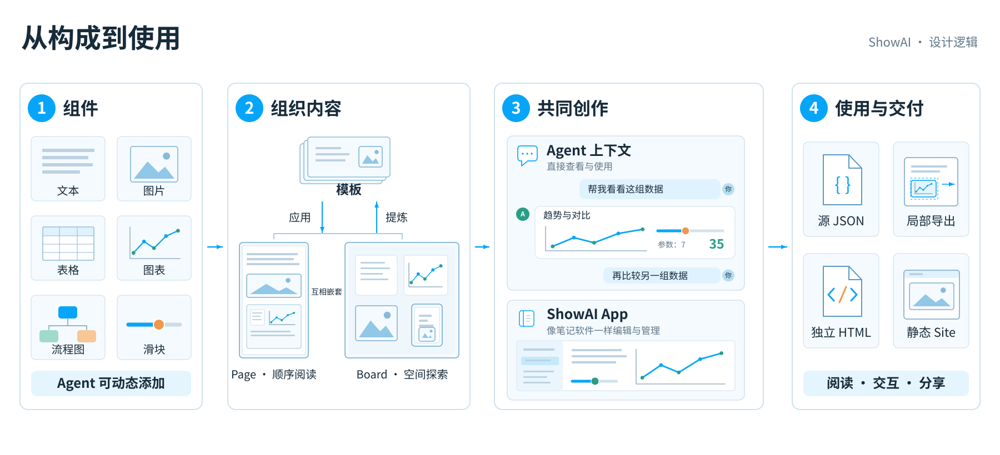

<p align="center">
  <a href="https://github.com/Renaissance-Mind/ShowAI/releases/latest"></a>
  <a href="https://showai.renaissancemind.ai/"></a>
  <a href="LICENSE"></a>
</p>

**Language:** English | [简体中文](docs/i18n/README.zh-CN.md)

[⬇ Download for Mac](https://github.com/Renaissance-Mind/ShowAI/releases/latest) · [Website](https://showai.renaissancemind.ai/) · [Quick start](docs/quick-start.md) · [Documentation](docs/README.md)

**The evolving interface between humans and agents.** Your agent's answers become interfaces — interactive, archived, and evolving as you use them.

- **Interactive** — agents answer with charts, calculators and diagrams you can adjust, compare and explore.
- **Archived** — ask your agent to save a result as a ShowAI page. Reopen the page, edit it together or export a copy.
- **Evolving** — when an expression is missing, the agent builds a new component; pages that work become templates, so each round starts from a better place.

https://github.com/user-attachments/assets/ecdccdec-1def-45a9-811f-121a7d07b906

<sub>Ask a question in your agent, get back an interface you can use, edit together and share. More examples at [showai.renaissancemind.ai](https://showai.renaissancemind.ai/).</sub>

## 🚀 Get started in 3 steps

This README describes `main`. For the exact menus and plugin setup in a downloaded build, follow the Quick start link in the [release notes for that version](https://github.com/Renaissance-Mind/ShowAI/releases).

ShowAI works inside the agent you already use: the plugin lets your agent build interfaces, and the ShowAI app keeps, opens and edits them.

The desktop app requires a Mac with Apple silicon and macOS 13 or later. Connect a supported host or use the built-in agent with a model API key. On Windows or Linux, run the [browser edition](#build-from-source).

1. **Download ShowAI** — get the [latest release](https://github.com/Renaissance-Mind/ShowAI/releases/latest), open the DMG and drag ShowAI into Applications. Current builds are not yet notarized by Apple; if macOS blocks the first launch, see [first launch](docs/quick-start.md#1-install-showai).
2. **Connect your agent** — open **Settings → Agent plugins** in ShowAI, select your host and follow its install or import steps. Start a new session after setup.
3. **Ask for an interface** — paste the sample prompt into a new conversation:

   > Use ShowAI to build a mortgage calculator with adjustable price, down payment, rate and term. Show the monthly payment and total interest, and save it as a ShowAI page.

A chat visualization is a temporary preview. The sample explicitly requests a saved page. Once saved, open it under **Recent** in ShowAI or use the page card or link your agent returns. [Troubleshoot the connection](docs/quick-start.md#if-the-agent-cant-find-showai).

## 🤖 Supported agents

| Host | Status | Installation | Presentation and editing |
| --- | --- | --- | --- |
| Codex | Supported | Install in Settings, refresh plugins and start a new chat. | Interact with previews in chat. Open a saved page card to edit the original or jump to a component in the side panel. Desktop builds with plugin extensions also offer a global workbench and selection references in chat. |
| Claude Code | Supported | Install in Settings and restart the session. | Sessions with an HTML display tool can show interactive previews and page cards. Desktop sessions can edit the original in an available browser or preview. Terminal sessions deliver an HTML file and a page link. |
| Antigravity | Supported | Install in Settings and restart the session. | Show interactive previews and page cards in chat. Edit originals, navigate to components and quote selections in the auxiliary pane, or browse projects in the global workbench. |
| DeepSeek Harness | Supported | Quit the host, then install from Settings. | The graphical client shows interactive previews and page cards in chat. Edit the original and quote a selection into the draft from a session tab, or open the global workbench from the left navigation. Terminal sessions deliver files or links. |
| Kimi Work | Supported | Register and install the plugin directory in the host. | A Widget can show offline interactive previews and page cards. Open the editable original in the host browser when it can reach the local machine, or use the ShowAI page link. |
| Cursor Agents | Supported | Install the local agent plugin and reload the window. | Show interactive previews and page cards in chat. Open the card’s live edit link in Cursor Browser to edit the original. |
| Cursor IDE | Supported | Install the VSIX and reload the window. | Show interactive previews and page cards in chat. Click a card or open a `.showai-ref` file to edit the original in an IDE pane. Use ShowAI: Open Workbench from the command palette to browse projects. |
| Qoder | Supported | Import the plugin ZIP in the host. | Show interactive previews and page cards in chat. A card navigates an open task editor, and the agent can open an original in a new right-side tab. More → ShowAI opens the global workbench. |
| WorkBuddy | Supported | Install from Settings or register the local marketplace. | Show interactive previews and page cards in chat. When a task provides an embedded browser, use the card’s edit link to open the original. |
| Kimi Code | Supported | Install the directory as a custom plugin. | Desktop opens interactive HTML in the file preview and edits the original in the task’s Browser pane. The CLI delivers the HTML file and an edit link. |
| TRAE IDE | Supported | Install the VSIX and import the separate MCP configuration. | Use ShowAI: Open Workbench from the command palette to browse projects and open a `.showai-ref` in an IDE tab to edit the original. The agent uses a separately configured MCP connection to deliver HTML files and page references. |
| Built-in agent | Supported | Configure local agent sign-in, a model API or Cloud in ShowAI. | Create, edit and present original pages inside a project. |
| ChatGPT on the web | Self-hosted | [Configure remote MCP and OAuth](docs/chatgpt.md). | Preview interactive content in chat and read or edit authorized projects. |
| T3 Code | Via the selected provider | Reuse the provider’s plugin or configure its MCP connection for the thread. | Show MCP Apps or HTML according to provider capabilities and open originals in T3 Browser. |
| Gemini CLI, OpenCode | Experimental | Configure the detected Gemini CLI or copy MCP settings into the client. | Read and write projects over MCP. Files and links follow the client’s capabilities. |

### Plugin paths by Agent host

When installing ShowAI from this repository, use the row for your current Agent host. Paths are relative to the repository root. Start ShowAI or register its runtime before following the local installation steps.

| Agent host                        | Repository directory or connection                                   | Install or connect                                                                                                                                                |
| --------------------------------- | -------------------------------------------------------------------- | ----------------------------------------------------------------------------------------------------------------------------------------------------------------- |
| Codex                             | [plugins/showai-codex/](plugins/showai-codex/)                       | Run `npm run plugin:install` from the checkout. [Source installation](docs/codex.md#install-from-a-source-checkout)                                               |
| Claude Code                       | [plugins/showai-claude/](plugins/showai-claude/)                     | Add this repository as a Claude Code marketplace and install `showai@renaissance-mind`. [Source installation](docs/codex.md#install-from-a-source-checkout)       |
| Antigravity                       | [plugins/showai-antigravity/](plugins/showai-antigravity/)           | Run `npm run plugin:antigravity` from the checkout. [Source installation](plugins/showai/README.md#from-a-source-checkout)                                        |
| DeepSeek Harness                  | [plugins/showai-deepseek/](plugins/showai-deepseek/) (bundle source) | ShowAI installs the bundle with the Harness CLI. For a source bundle, run `npm run plugin:dsh`. [Bundle setup](plugins/showai/README.md#deepseek-harness)       |
| Kimi Work                         | [plugins/showai-kimi/](plugins/showai-kimi/)                         | In Kimi Work, register and install this exact subdirectory. [Kimi Work setup](plugins/showai-kimi/README.md#install-and-update)                                   |
| Cursor Agents                     | [plugins/showai/](plugins/showai/) → `--host cursor`                 | Install the local Agent plugin and reload the window. [Cursor setup](plugins/showai/README.md#cursor-qoder-and-workbuddy)                                         |
| Cursor IDE                        | [Cursor IDE extension source](plugins/showai/host-adapters/cursor-ide/) | Prepare the VSIX from ShowAI Settings or run `npm run package:cursor -- --out showai-workbench.vsix`. [Cursor setup](plugins/showai/README.md#cursor-qoder-and-workbuddy) |
| TRAE IDE                          | [ShowAI Workbench extension source](plugins/showai/host-adapters/cursor-ide/) | Prepare the VSIX and MCP settings. [TRAE setup](plugins/showai/README.md#kimi-code-and-trae) |
| Kimi Code                         | [plugins/showai/](plugins/showai/) → `--host kimi-code` | Prepare a Kimi Code plugin or use its MCP configuration. [Kimi Code setup](plugins/showai/README.md#kimi-code-and-trae) |
| Qoder                             | [plugins/showai/](plugins/showai/) → `--host qoder`                  | Generate a ZIP and import it in **Extensions → Plugins → Add plugin**. [Qoder setup](plugins/showai/README.md#cursor-qoder-and-workbuddy)                         |
| WorkBuddy                         | [plugins/showai/](plugins/showai/) → `--host workbuddy`              | Generate a local marketplace package, or add ShowAI in **Connectors → Custom connectors**. [WorkBuddy setup](plugins/showai/README.md#cursor-qoder-and-workbuddy) |
| ChatGPT on the web                | [plugins/showai/](plugins/showai/) → `--chatgpt-app`                 | [Register a remote MCP connection](docs/chatgpt.md#connect-chatgpt) and attach it to a universal package if needed.                                               |
| Other compatible clients | [plugins/showai/](plugins/showai/)                                   | [Generate the universal package](plugins/showai/README.md#universal-plugin-and-manual-mcp-setup) with a known connection, or use the included setup guide.        |

## 💡 See what it makes

| [Kyoto in five days](https://showai.renaissancemind.ai/?project=173ce4da-05f8-4913-b66a-da214d23b4cb&page=f3641d0c-a605-44ca-a523-79fe532eac65) | [Attention, step by step](https://showai.renaissancemind.ai/?project=173ce4da-05f8-4913-b66a-da214d23b4cb&page=1d0f36da-d0e5-4f26-97bc-158217916fa8) | [Which foldable to buy?](https://showai.renaissancemind.ai/?project=173ce4da-05f8-4913-b66a-da214d23b4cb&page=cb8ed801-1670-45c1-bf19-d97dafddcea2) |
| ----------------------------------------------------------------------------------------------------------------------------------------------- | ---------------------------------------------------------------------------------------------------------------------------------------------------- | --------------------------------------------------------------------------------------------------------------------------------------------------- |
| A five-day route you can switch day by day                                                                                                      | Step through how attention weights are computed                                                                                                      | Re-rank phones by the criteria you care about                                                                                                       |

Each page opens in the online workbench, where you can operate and edit it.

## 🌱 Why ShowAI

As agents take on more work, the bottleneck moves from what agents can do to whether people can understand, judge and steer it. ShowAI is the evolving interface between humans and agents: agents hand their work to people through it, people understand, edit and build on it, and the interface itself stays interactive, archived and keeps evolving with use.


## 🧩 How it works



1. **Components express information.** Text, images, tables, charts, flow diagrams and sliders give different ways to express and interact. Agents choose existing components or create new ones for a task, such as controls that let readers adjust parameters and inspect the results.
2. **Pages and templates organize it.** A [Page](docs/page-surface.md) arranges articles and reports in sequence; a Board uses spatial layout for relationships and proposals. Common structures and component combinations become templates. See [Components and templates](docs/catalog-lifecycle.md).
3. **You and the agent work on the same page.** In agents that display pages, the interface appears in the chat; the ShowAI app is a workbench where you manage projects, edit directly and reuse components. The agent reads your edits before continuing.
4. **Results stay usable.** Standalone HTML keeps reading and interaction without ShowAI installed, a static site shares several pages through one URL, and source JSON can be imported to keep editing.

## ✨ Features

**Interactive**

- **Intelligent UI**: The agent's answer becomes an interactive page built from blocks, charts, boards and components rather than a block of Markdown.
- **Human–Agent Brainstorming**: Write, draw and ask on the same canvas. Select any text, cell or board object to have the agent expand, reorganize or visualize it, with several conversations advancing one project in parallel.

**Archived**

- **Living Archive**: Saved pages belong to a local project. ShowAI stores their current content in SQLite and protects edits with undo, drafts and conflict recovery.
- **Local-first, share when you want**: Fully usable with no account. Connect a self-hosted server for collaboration, or export an offline, interactive HTML file.

**Evolving**

- **Evolving Presentation**: Components, templates and presentation methods are explicit and versioned. When an expression is missing the agent adds a component; good work can be distilled into a template, so every round builds on the last.

**Across devices**

- **Cross-device**: Pair an iPad with a Mac to share one body of content, and run agent tasks on this device, in the cloud or on the paired Mac. The iPad app is not yet publicly available.

## 📦 Share pages and sites

| Export format       | Use                                              |
| ------------------- | ------------------------------------------------ |
| **Standalone HTML** | Sharing, offline reading, and archiving          |
| **Inline fragment** | Display in agent conversations that support HTML |
| **Static site**     | Multiple-page navigation and static hosting      |

Export from a page's menu in the app, or ask your agent. Standalone HTML keeps interactions such as switching charts, collapsing content and local calculations offline; external links need a network and images must be embedded. HTML exports also save a `.showai.json` source for importing and further editing. Command-line export is described in the [CLI reference](docs/agent-usage.md).

## 🔒 Content and synchronization

Project content is stored locally in a transactional SQLite library (`~/.showai` by default) that can be backed up or migrated. Saves check for concurrent edits; local drafts and conflict recovery preserve unfinished work. For collaboration across devices or with other people, connect ShowAI Cloud or a self-hosted ShowAI Server and synchronize by project with administrator, editor and viewer roles. See [Content library](docs/versioned-library.md) and [Project server and synchronization](docs/project-sync.md).

## Build from source

Running from source requires **Node.js 22.12+** and npm. The local browser edition supports macOS, Linux and Windows.

```sh
git clone https://github.com/Renaissance-Mind/ShowAI.git
cd ShowAI
npm ci
npm run build:browser
npm run browser
```

Keep the terminal running while you use the browser workbench; press `Ctrl+C` to stop it. To build and launch the desktop app from the same checkout:

```sh
npm run build
npm run desktop
```

Install the plugin from a source checkout instead of the app — Codex (requires the [Codex CLI](https://github.com/openai/codex) on your `PATH`):

```sh
npm run plugin:install
```

Claude Code:

```sh
claude plugin marketplace add ./
claude plugin install showai@renaissance-mind
```

Start the app once, or run `npm run runtime:register`, so the plugin can find the runtime in your content library. See the [plugin documentation](plugins/showai/README.md) for the six Skills and connection details, [Local browser edition](docs/local-browser.md) for launchers and packaging, and the [CLI reference](docs/agent-usage.md) for scripting.

## 📚 Documentation

All guides have paired English and Simplified Chinese editions. Browse the [complete English index](docs/README.md) or [中文文档目录](docs/i18n/index.zh-CN.md).

| Start here                                    | Build and integrate                                   | Store and share                                |
| --------------------------------------------- | ----------------------------------------------------- | ---------------------------------------------- |
| [Quick start](docs/quick-start.md)            | [Components and templates](docs/catalog-lifecycle.md) | [Content library](docs/versioned-library.md)   |
| [Use in Claude Code and Codex](docs/codex.md) | [Template folders](docs/template-bundles.md)          | [Cloud and accounts](docs/cloud.md)            |
| [Built-in agent](docs/agent-host.md)          | [Component parameters](docs/component-parameters.md)  | [Project sync](docs/project-sync.md)           |
| [Page and Board](docs/page-surface.md)        | [Agent integration](docs/agent-integration.md)        | [Server operations](docs/server-operations.md) |
| [ChatGPT web (local MCP)](docs/chatgpt.md)    | [Artifact format v3](docs/artifact-format.md)         | [MCP deployment](docs/cloud-mcp-deployment.md) |

## 🛠️ Development and contributions

ShowAI uses React, TypeScript, Electron and Vite. Rich text editing uses Tiptap, flow diagrams use React Flow, and data visualization uses G2.

```sh
npm run dev:open     # desktop workbench with hot reload
npm run dev:status   # check the current development service
```

Use `npm run dev:browser` for browser development. See [CONTRIBUTING.md](CONTRIBUTING.md) for isolated development instances, ports and the checks to run before submitting (`npm run check`, `npm test`, `npm run build`).

Use [Issues](https://github.com/Renaissance-Mind/ShowAI/issues) to report problems or suggest use cases, or contribute code, components, templates and documentation through a pull request. Include your environment, reproduction steps, and expected and actual results when reporting a problem.

## License

ShowAI is licensed under the [MIT License](LICENSE).
