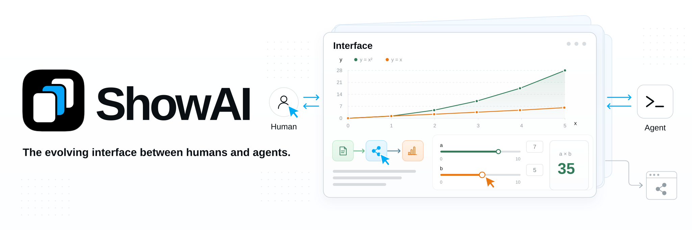
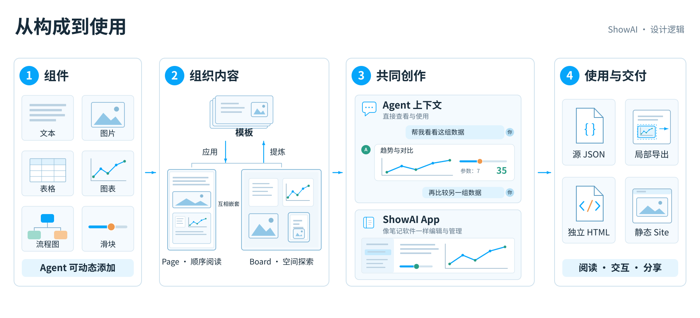

<p align="center">
  <a href="https://github.com/Renaissance-Mind/ShowAI/releases/latest"></a>
  <a href="https://showai.renaissancemind.ai/"></a>
  <a href="LICENSE"></a>
</p>

**Language:** English | [简体中文](docs/i18n/README.zh-CN.md)

[⬇ Download for Mac](https://github.com/Renaissance-Mind/ShowAI/releases/latest) · [Website](https://showai.renaissancemind.ai/) · [Quick start](docs/quick-start.md) · [Documentation](docs/README.md)

**The evolving interface between humans and agents.** Your agent's answers become interfaces — interactive, archived, and evolving as you use them.

- **Interactive** — agents answer with charts, calculators and diagrams you can adjust, compare and explore.
- **Archived** — every interface is saved as your own page with full history; the agent continues from your edits, and you can export it for others.
- **Evolving** — when an expression is missing, the agent builds a new component; pages that work become templates, so each round starts from a better place.

https://github.com/user-attachments/assets/ecdccdec-1def-45a9-811f-121a7d07b906

<sub>Ask a question in your agent, get back an interface you can use, edit together and share. More examples at [showai.renaissancemind.ai](https://showai.renaissancemind.ai/).</sub>

## 🚀 Get started in 3 steps

ShowAI works inside the agent you already use: the plugin lets your agent build interfaces, and the ShowAI app keeps, opens and edits them.

You need a Mac with Apple silicon (macOS 13 or later), and Claude Code or Codex signed in. No agent yet? Use the built-in agent with a model API key. On Windows or Linux, run the [browser edition](#build-from-source).

1. **Download ShowAI** — get the [latest release](https://github.com/Renaissance-Mind/ShowAI/releases/latest), open the DMG and drag ShowAI into Applications. Current builds are not yet notarized by Apple; if macOS blocks the first launch, see [first launch](docs/quick-start.md#1-install-showai).
2. **Connect your agent** — open ShowAI and install the plugin for Claude Code or Codex from the welcome screen (or **Settings → Plugins**), then restart the agent.
3. **Ask for an interface** — paste the sample prompt into a new conversation:

   > Use ShowAI to build a mortgage calculator: price, down payment, rate and term are adjustable; show the monthly payment and total interest.

The agent saves the interface in ShowAI and shows it in the conversation (or as an HTML file in agents that can't display it); in the app it appears under **Recent**. Edit it there, or ask the agent to continue from your changes. Not working? See [If the agent can't find ShowAI](docs/quick-start.md#if-the-agent-cant-find-showai).

## 🤖 Supported agents

| Agent                                     | Status       | How to connect                                                                                                                         |
| ----------------------------------------- | ------------ | -------------------------------------------------------------------------------------------------------------------------------------- |
| Claude Code                               | Supported    | ShowAI → **Settings → Plugins** → Install plugin                                                                                       |
| Codex                                     | Supported    | ShowAI → **Settings → Plugins** → Install plugin                                                                                       |
| Built-in agent                            | Supported    | Inside ShowAI, using your local Codex or Claude Code sign-in, a model API key or Cloud                                                 |
| DeepSeek Harness                          | Preview      | ShowAI → **Settings → Plugins** → Prepare plugin, then add it in DeepSeek Harness ([steps](plugins/showai/README.md#deepseek-harness)) |
| Kimi Work                                 | Preview      | Add ShowAI's MCP server and the [Kimi plugin](plugins-kimi/showai/README.md) in Kimi Work                                              |
| ChatGPT on the web                        | Invite only  | Hosted MCP with a ShowAI Cloud account; registration needs a key or a project invitation ([guide](docs/chatgpt.md))                    |
| Other MCP clients (Gemini CLI, OpenCode…) | Experimental | Configure the stdio MCP entry by hand ([Agent integration](docs/agent-integration.md))                                                 |

## 💡 See what it makes

| [Kyoto in five days](https://showai.renaissancemind.ai/?project=173ce4da-05f8-4913-b66a-da214d23b4cb&page=f3641d0c-a605-44ca-a523-79fe532eac65) | [Attention, step by step](https://showai.renaissancemind.ai/?project=173ce4da-05f8-4913-b66a-da214d23b4cb&page=1d0f36da-d0e5-4f26-97bc-158217916fa8) | [Which foldable to buy?](https://showai.renaissancemind.ai/?project=173ce4da-05f8-4913-b66a-da214d23b4cb&page=cb8ed801-1670-45c1-bf19-d97dafddcea2) |
| ----------------------------------------------------------------------------------------------------------------------------------------------- | ---------------------------------------------------------------------------------------------------------------------------------------------------- | --------------------------------------------------------------------------------------------------------------------------------------------------- |
| A five-day route you can switch day by day                                                                                                      | Step through how attention weights are computed                                                                                                      | Re-rank phones by the criteria you care about                                                                                                       |

Each page opens in the online workbench, where you can operate and edit it.

## 🌱 Why ShowAI

As agents take on more work, the bottleneck moves from what agents can do to whether people can understand, judge and steer it. ShowAI is the evolving interface between humans and agents: agents hand their work to people through it, people understand, edit and build on it, and the interface itself stays interactive, archived and keeps evolving with use.


## 🧩 How it works



1. **Components express information.** Text, images, tables, charts, flow diagrams and sliders give different ways to express and interact. Agents choose existing components or create new ones for a task, such as controls that let readers adjust parameters and inspect the results.
2. **Pages and templates organize it.** A [Page](docs/page-surface.md) arranges articles and reports in sequence; a Board uses spatial layout for relationships and proposals. Common structures and component combinations become templates. See [Components and templates](docs/catalog-lifecycle.md).
3. **You and the agent work on the same page.** In agents that display pages, the interface appears in the chat; the ShowAI app is a workbench where you manage projects, edit directly and reuse components. The agent reads your edits before continuing.
4. **Results stay usable.** Standalone HTML keeps reading and interaction without ShowAI installed, a static site shares several pages through one URL, and source JSON can be imported to keep editing.

## ✨ Features

**Interactive**

- **Intelligent UI**: The agent's answer becomes an interactive page built from blocks, charts, boards and components rather than a block of Markdown.
- **Human–Agent Brainstorming**: Write, draw and ask on the same canvas. Select any text, cell or board object to have the agent expand, reorganize or visualize it, with several conversations advancing one project in parallel.

**Archived**

- **Living Archive**: Output lands as versioned files in a local project bound to your source directory, with full history and conflict protection, ready to be continued, reused or broken into new material.
- **Local-first, share when you want**: Fully usable with no account. Connect a self-hosted server for collaboration, or export an offline, interactive HTML file.

**Evolving**

- **Evolving Presentation**: Components, templates and presentation methods are explicit and versioned. When an expression is missing the agent adds a component; good work can be distilled into a template, so every round builds on the last.

**Across devices**

- **Cross-device**: Pair an iPad with a Mac to share one body of content, and run agent tasks on this device, in the cloud or on the paired Mac. The iPad app is not yet publicly available.

## 📦 Share pages and sites

| Export format       | Use                                              |
| ------------------- | ------------------------------------------------ |
| **Standalone HTML** | Sharing, offline reading, and archiving          |
| **Inline fragment** | Display in agent conversations that support HTML |
| **Static site**     | Multiple-page navigation and static hosting      |

Export from a page's menu in the app, or ask your agent. Standalone HTML keeps interactions such as switching charts, collapsing content and local calculations offline; external links need a network and images must be embedded. HTML exports also save a `.showai.json` source for importing and further editing. Command-line export is described in the [CLI reference](docs/agent-usage.md).

## 🔒 Content and synchronization

Project content is stored locally in a transactional SQLite library (`~/.showai` by default) that can be backed up or migrated. Saves check for concurrent edits; local drafts and conflict recovery preserve unfinished work. For collaboration across devices or with other people, connect ShowAI Cloud or a self-hosted ShowAI Server and synchronize by project with administrator, editor and viewer roles. See [Content library](docs/versioned-library.md) and [Project server and synchronization](docs/project-sync.md).

## Build from source

Running from source requires **Node.js 22.12+** and npm. The local browser edition supports macOS, Linux and Windows.

```sh
git clone https://github.com/Renaissance-Mind/ShowAI.git
cd ShowAI
npm ci
npm run build:browser
npm run browser
```

Keep the terminal running while you use the browser workbench; press `Ctrl+C` to stop it. To build and launch the desktop app from the same checkout:

```sh
npm run build
npm run desktop
```

Install the plugin from a source checkout instead of the app — Codex (requires the [Codex CLI](https://github.com/openai/codex) on your `PATH`):

```sh
npm run plugin:install
```

Claude Code:

```sh
claude plugin marketplace add ./
claude plugin install showai@renaissance-mind
```

Start the app once, or run `npm run runtime:register`, so the plugin can find the runtime in your content library. See the [plugin documentation](plugins/showai/README.md) for the eight Skills and connection details, [Local browser edition](docs/local-browser.md) for launchers and packaging, and the [CLI reference](docs/agent-usage.md) for scripting.

## 📚 Documentation

All guides have paired English and Simplified Chinese editions. Browse the [complete English index](docs/README.md) or [中文文档目录](docs/i18n/index.zh-CN.md).

| Start here                                    | Build and integrate                                   | Store and share                                |
| --------------------------------------------- | ----------------------------------------------------- | ---------------------------------------------- |
| [Quick start](docs/quick-start.md)            | [Components and templates](docs/catalog-lifecycle.md) | [Content library](docs/versioned-library.md)   |
| [Use in Claude Code and Codex](docs/codex.md) | [Template folders](docs/template-bundles.md)          | [Cloud and accounts](docs/cloud.md)            |
| [Built-in agent](docs/agent-host.md)          | [Component parameters](docs/component-parameters.md)  | [Project sync](docs/project-sync.md)           |
| [Page and Board](docs/page-surface.md)        | [Agent integration](docs/agent-integration.md)        | [Server operations](docs/server-operations.md) |
| [ChatGPT web (invite only)](docs/chatgpt.md)  | [Artifact format v3](docs/artifact-format.md)         | [MCP deployment](docs/cloud-mcp-deployment.md) |

## 🛠️ Development and contributions

ShowAI uses React, TypeScript, Electron and Vite. Rich text editing uses Tiptap, flow diagrams use React Flow, and data visualization uses G2.

```sh
npm run dev:open     # desktop workbench with hot reload
npm run dev:status   # check the current development service
```

Use `npm run dev:browser` for browser development. See [CONTRIBUTING.md](CONTRIBUTING.md) for isolated development instances, ports and the checks to run before submitting (`npm run check`, `npm test`, `npm run build`).

Use [Issues](https://github.com/Renaissance-Mind/ShowAI/issues) to report problems or suggest use cases, or contribute code, components, templates and documentation through a pull request. Include your environment, reproduction steps, and expected and actual results when reporting a problem.

## License

ShowAI is licensed under the [MIT License](LICENSE).
