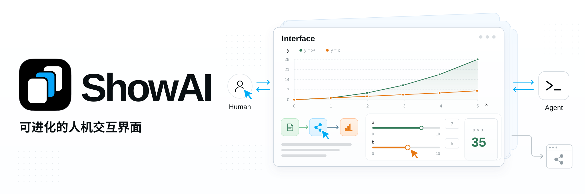
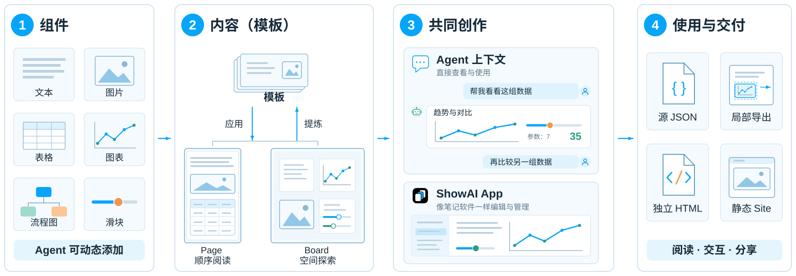

<p align="center">
  <a href="https://github.com/Renaissance-Mind/ShowAI/releases/latest"></a>
  <a href="https://showai.renaissancemind.ai/"></a>
  <a href="../../LICENSE"></a>
</p>

**语言:** [English](../../README.md) | 简体中文

[⬇ 下载 macOS 版](https://github.com/Renaissance-Mind/ShowAI/releases/latest) · [官网](https://showai.renaissancemind.ai/) · [快速上手](quick-start.zh-CN.md) · [文档](index.zh-CN.md)

**可进化的人机交互界面。** Agent 的回答不再只是一段文字，而是一个可以交互、可以归档、在使用中不断进化的界面。

- **可以交互**：Agent 用图表、计算器、流程图等组件回答，你可以调参数、做对比、展开细节，在操作中理解。
- **可以归档**：让 Agent 把结果保存为 ShowAI 页面。你可以随时打开原页，和 Agent 接着改，也可以导出一份交给别人。
- **在使用中进化**：缺少合适的表达时，Agent 会写出新组件；好用的页面可以沉淀为模板，下一次从更好的起点开始。

https://github.com/user-attachments/assets/375d6ff3-fe3e-47c2-b6a4-d69df1b86b20

<sub>在你的 Agent 里提问，得到一个能用、能一起改、能分享的界面。更多示例见 [showai.renaissancemind.ai](https://showai.renaissancemind.ai/)。</sub>

## 🚀 三步开始

本文按 `main` 的实现说明操作。使用已下载的安装包时，可从[对应版本的发行说明](https://github.com/Renaissance-Mind/ShowAI/releases)打开随该版本提供的入门指南。

ShowAI 在你已经在用的 Agent 里工作：装上插件后，Agent 就能把回答做成界面；ShowAI App 负责保存、打开和继续编辑这些界面。

需要：Apple Silicon Mac（macOS 13 或更高版本），以及已登录的 Claude Code 或 Codex（也可以在 App 中填写模型 API Key）。使用 Windows 或 Linux 时，运行[浏览器版](#从源码构建)。

1. **下载 ShowAI** — 下载[最新版本](https://github.com/Renaissance-Mind/ShowAI/releases/latest)，打开 DMG，把 ShowAI 拖进「应用程序」。当前版本尚未经过 Apple 公证；macOS 阻止首次打开时，见[首次打开](quick-start.zh-CN.md#1-安装-showai)。
2. **连接你的 Agent** — 打开 ShowAI，在欢迎页（或「设置 → Agent 插件」）为 Claude Code 或 Codex 安装插件，然后重启 Agent。
3. **让 Agent 做第一个界面** — 在新对话中粘贴示例提示词：

   > 用 ShowAI 做一个房贷计算器。让我调整房价、首付比例、利率和期限，显示月供和总利息，并保存为 ShowAI 页面。

聊天里的可视化可以临时展示。上面的提示词明确要求保存页面，保存后就能从 ShowAI 的「最近」或宿主返回的页面卡片、链接打开原页，继续编辑。[排查连接问题](quick-start.zh-CN.md#agent-找不到-showai-时)。

## 🤖 支持的 Agent

| Agent                                      | 状态     | 接入方式                                                                                                                       |
| ------------------------------------------ | -------- | ------------------------------------------------------------------------------------------------------------------------------ |
| Claude Code                                | 正式     | ShowAI「设置 → Agent 插件」→ 安装插件                                                                                                |
| Codex                                      | 正式     | ShowAI「设置 → Agent 插件」→ 安装插件                                                                                                |
| Antigravity                                | 正式     | ShowAI「设置 → Agent 插件」→ 安装插件                                                                                                |
| 内置 Agent                                 | 正式     | 在 ShowAI 中使用本机 Codex 或 Claude Code 的登录、模型 API Key 或 Cloud                                                        |
| DeepSeek Harness                           | 预览     | 完全退出 DeepSeek Harness，在 ShowAI「设置 → Agent 插件」点「安装插件」（[步骤](../../plugins/showai/README.zh-CN.md#deepseek-harness)） |
| Kimi Work                                  | 预览     | 在「设置 → Agent 插件」准备插件目录，再[在 Kimi Work 中安装](../../plugins/showai-kimi/README.md)                                      |
| Cursor、Qoder、WorkBuddy                   | 预览     | 「设置 → Agent 插件」可直接安装已检测到的 Cursor 和 WorkBuddy。Qoder 通过 ZIP 导入。[安装说明](../../plugins/showai/README.zh-CN.md#cursorqoder-和-workbuddy) |
| 网页版 ChatGPT                             | 自行部署 | 在桌面 App 开启远程连接，使用自己的 Cloudflare 或 Tailscale 接入本机项目（[指南](chatgpt.zh-CN.md)）                           |
| Kimi Code、TRAE IDE | 预览 | 在「设置 → Agent 插件」准备 Kimi Code 安装包，或直接安装已检测到的 TRAE 扩展。[接入说明](../../plugins/showai/README.zh-CN.md#kimi-code-和-trae) |
| Gemini CLI、OpenCode | 实验 | 在「设置 → Agent 插件」为已检测到的 Gemini CLI 配置 MCP，或复制相应客户端的配置。[Agent 接入](agent-integration.zh-CN.md) |

### 按 Agent 宿主选择插件目录

从本仓库安装 ShowAI 时，按当前运行的 Agent 宿主查下表。目录均相对于仓库根。本机接入前先启动 ShowAI 或登记其运行时。

| Agent 宿主            | 仓库目录或连接方式                                                        | 安装或接入                                                                                                                                                |
| --------------------- | ------------------------------------------------------------------------- | --------------------------------------------------------------------------------------------------------------------------------------------------------- |
| Codex                 | [plugins/showai-codex/](../../plugins/showai-codex/)                      | 在源码目录运行 `npm run plugin:install`。[源码安装说明](codex.zh-CN.md#从源码安装)                                                                        |
| Claude Code           | [plugins/showai-claude/](../../plugins/showai-claude/)                    | 将本仓库添加为 Claude Code 插件市场，安装 `showai@renaissance-mind`。[源码安装说明](codex.zh-CN.md#从源码安装)                                            |
| Antigravity           | [plugins/showai-antigravity/](../../plugins/showai-antigravity/)          | 在源码目录运行 `npm run plugin:antigravity`。[源码安装说明](../../plugins/showai/README.zh-CN.md#从源码安装)                                              |
| DeepSeek Harness      | [plugins/showai-deepseek/](../../plugins/showai-deepseek/)（bundle 源码） | ShowAI 通过 Harness CLI 安装。源码方式可用 `npm run plugin:dsh` 准备插件包。[准备并启用 bundle](../../plugins/showai/README.zh-CN.md#deepseek-harness) |
| Kimi Work             | [plugins/showai-kimi/](../../plugins/showai-kimi/)                        | 在 Kimi Work 中指定这个子目录，注册后安装。[Kimi Work 安装说明](../../plugins/showai-kimi/README.md#安装与更新)                                           |
| Cursor Agents         | [plugins/showai/](../../plugins/showai/) → `--host cursor`                | 安装本地 Agent 插件并重载窗口。[Cursor 接入](../../plugins/showai/README.zh-CN.md#cursorqoder-和-workbuddy)                                              |
| Cursor IDE            | [Cursor IDE 扩展源码](../../plugins/showai/host-adapters/cursor-ide/)      | 在 ShowAI 设置准备 VSIX，或运行 `npm run package:cursor -- --out showai-workbench.vsix`。[Cursor 接入](../../plugins/showai/README.zh-CN.md#cursorqoder-和-workbuddy) |
| TRAE IDE              | [ShowAI 工作台扩展源码](../../plugins/showai/host-adapters/cursor-ide/) | 准备 VSIX 和 MCP 配置。[TRAE 接入](../../plugins/showai/README.zh-CN.md#kimi-code-和-trae) |
| Kimi Code             | [plugins/showai/](../../plugins/showai/) → `--host kimi-code` | 准备 Kimi Code 专用插件或使用 MCP 配置。[Kimi Code 接入](../../plugins/showai/README.zh-CN.md#kimi-code-和-trae) |
| Qoder                 | [plugins/showai/](../../plugins/showai/) → `--host qoder`                 | 生成 ZIP，在「扩展 → 插件 → 添加插件」中导入。[Qoder 接入](../../plugins/showai/README.zh-CN.md#cursorqoder-和-workbuddy)                                 |
| WorkBuddy             | [plugins/showai/](../../plugins/showai/) → `--host workbuddy`             | 生成本地插件市场包，或在「连接器 → 自定义连接器」添加 ShowAI。[WorkBuddy 接入](../../plugins/showai/README.zh-CN.md#cursorqoder-和-workbuddy)             |
| 网页版 ChatGPT        | [plugins/showai/](../../plugins/showai/) → `--chatgpt-app`                | [注册远程 MCP 连接](chatgpt.zh-CN.md#连接-chatgpt)，需要时将通用包关联到这个连接。                                                                        |
| 其他兼容客户端 | [plugins/showai/](../../plugins/showai/)                                  | [生成通用包](../../plugins/showai/README.zh-CN.md#通用插件与手动连接)，按已知连接附上配置，或使用包内接入向导。                                           |

## 💡 看看做出来的样子

| [京都五日：慢慢走](https://showai.renaissancemind.ai/?project=173ce4da-05f8-4913-b66a-da214d23b4cb&page=f3641d0c-a605-44ca-a523-79fe532eac65) | [注意力机制，一步步看懂](https://showai.renaissancemind.ai/?project=173ce4da-05f8-4913-b66a-da214d23b4cb&page=1d0f36da-d0e5-4f26-97bc-158217916fa8) | [该买哪台折叠屏？](https://showai.renaissancemind.ai/?project=173ce4da-05f8-4913-b66a-da214d23b4cb&page=cb8ed801-1670-45c1-bf19-d97dafddcea2) |
| --------------------------------------------------------------------------------------------------------------------------------------------- | --------------------------------------------------------------------------------------------------------------------------------------------------- | --------------------------------------------------------------------------------------------------------------------------------------------- |
| 可以按天切换的五日路线                                                                                                                        | 一步步看注意力权重怎样计算                                                                                                                          | 按你在意的标准重新给机型排序                                                                                                                  |

每一页都会在在线工作台中打开，可以直接操作和修改。

## 🌱 为什么是 ShowAI

Agent 能做的事越来越多，瓶颈正在从 Agent 能做什么，转向人能否理解、判断并参与它的工作。ShowAI 是可进化的人机交互界面：Agent 通过它把工作交给人，人通过它理解、修改并继续推进；界面本身可以交互、可以归档，并在使用中进化。


## 🧩 它怎样工作



1. **组件负责表达。** 文本、图片、表格、图表、流程图和滑块提供不同的表达与交互方式。Agent 可以选择已有组件，也可以为任务创建新组件，例如让读者调整参数、观察计算结果的控件。
2. **页面与模板负责组织。** [Page](page-surface.zh-CN.md) 按顺序组织文章与报告，Board 用空间布局组织关系与方案。常用结构和组件组合可以保存为模板。详见[组件与模板说明](catalog-lifecycle.zh-CN.md)。
3. **你和 Agent 在同一份页面上工作。** 在支持页面展示的 Agent 中，界面直接出现在对话里；ShowAI App 是管理项目、直接编辑和复用组件的工作台。Agent 继续之前会先读取你的修改。
4. **成果可以继续使用。** 独立 HTML 不安装 ShowAI 也能阅读和交互，静态网站通过一个网址分享多页内容，源 JSON 可以导入后继续编辑。

## ✨ Features

**可以交互**

- **Intelligent UI**：Agent 的回答直接生成为由区块、图表、画布和组件构成的可交互页面，而不是一段 Markdown。
- **Human-Agent Brainstorming**：在同一块画布上边写边画边问，选中任意文字、单元格或画布对象就能让 Agent 展开、重组或可视化，多个对话可以并行推进同一个项目。

**可以归档**

- **Living Archive**：保存的页面归入本机项目。ShowAI 用 SQLite 管理当前内容，通过编辑撤销、草稿和冲突恢复保护修改。
- **Local-first, share when you want**：不开账号也能完整使用，需要时接自建服务器多人协作，或导出一个离线可交互的 HTML。

**在使用中进化**

- **Evolving Presentation**：组件、模板和呈现方法都是显式且版本化的，Agent 缺什么表达就补什么组件，做得好的作品可提炼为模板，每一轮都在为下一轮积累。

**跨设备**

- **Cross-device**：iPad 与 Mac 配对后共用同一份内容，Agent 任务可以在本机、云端或配对的 Mac 上执行。iPad App 尚未公开提供。

## 📦 分享页面与 Site

| 导出格式        | 适用场景                            |
| --------------- | ----------------------------------- |
| **独立 HTML**   | 分享、离线阅读和归档                |
| **inline 片段** | 在支持 HTML 展示的 Agent 对话中呈现 |
| **静态网站**    | 多页面导航与静态托管                |

在 App 的页面菜单中导出，或直接让 Agent 导出。独立 HTML 离线保留图表切换、折叠内容和本地计算等交互；外部链接需要联网，图片需要内嵌。HTML 导出同时保存 `.showai.json` 源文件，便于重新导入和继续编辑。命令行导出见 [CLI 参考](agent-usage.zh-CN.md)。

## 🔒 内容与同步

项目内容保存在本机的 SQLite 内容库（默认 `~/.showai`），支持备份与迁移。保存会检查并发修改，本地草稿与冲突恢复保留未完成的工作。跨设备或与他人协作时，连接 ShowAI Cloud 或自部署的 ShowAI Server，按项目同步，并以管理员、编辑者与查看者角色管理权限。见[内容库](versioned-library.zh-CN.md)与[项目服务器与同步](project-sync.zh-CN.md)。

## 从源码构建

从源码运行需要 **Node.js 22.12+** 和 npm。本地浏览器版支持 macOS、Linux 和 Windows。

```sh
git clone https://github.com/Renaissance-Mind/ShowAI.git
cd ShowAI
npm ci
npm run build:browser
npm run browser
```

使用浏览器工作台期间保持终端运行，按 `Ctrl+C` 停止。在同一份代码中构建并启动桌面应用：

```sh
npm run build
npm run desktop
```

不通过 App，而是从源码安装插件 — Codex（需要 [Codex CLI](https://github.com/openai/codex) 在 `PATH` 中）：

```sh
npm run plugin:install
```

Claude Code：

```sh
claude plugin marketplace add ./
claude plugin install showai@renaissance-mind
```

先启动一次 App，或执行 `npm run runtime:register`，插件才能在内容库中找到运行时。六个 Skill 与接入细节见[插件说明](../../plugins/showai/README.zh-CN.md)，启动器与打包见[本地浏览器版](local-browser.zh-CN.md)，脚本用法见 [CLI 参考](agent-usage.zh-CN.md)。

## 📚 文档

全部使用与技术指南均有中英文版本及语言切换。浏览[中文文档目录](index.zh-CN.md)或 [English index](../README.md)。

| 开始使用                                         | 创作与集成                                  | 保存与分享                                |
| ------------------------------------------------ | ------------------------------------------- | ----------------------------------------- |
| [快速上手](quick-start.zh-CN.md)                 | [组件与模板](catalog-lifecycle.zh-CN.md)    | [内容库](versioned-library.zh-CN.md)      |
| [在 Claude Code 与 Codex 中使用](codex.zh-CN.md) | [模板文件夹](template-bundles.zh-CN.md)     | [Cloud 与账号](cloud.zh-CN.md)            |
| [内置 Agent](agent-host.zh-CN.md)                | [组件参数](component-parameters.zh-CN.md)   | [项目同步](project-sync.zh-CN.md)         |
| [Page 与 Board](page-surface.zh-CN.md)           | [Agent 接入](agent-integration.zh-CN.md)    | [服务器运维](server-operations.zh-CN.md)  |
| [网页版 ChatGPT（本机 MCP）](chatgpt.zh-CN.md)   | [页面数据格式 v3](artifact-format.zh-CN.md) | [MCP 部署](cloud-mcp-deployment.zh-CN.md) |

## 🛠️ 开发与贡献

ShowAI 使用 React、TypeScript、Electron 与 Vite。富文本编辑基于 Tiptap，流程图基于 React Flow，数据可视化使用 G2。

```sh
npm run dev:open     # 支持热更新的完整桌面工作台
npm run dev:status   # 查看当前开发服务
```

浏览器开发版使用 `npm run dev:browser`。隔离的开发实例、端口，以及提交前要执行的检查（`npm run check`、`npm test`、`npm run build`）见[贡献指南](CONTRIBUTING.zh-CN.md)。

欢迎通过 [Issues](https://github.com/Renaissance-Mind/ShowAI/issues) 反馈问题、提出使用场景，或通过 Pull Request 贡献代码、组件、模板与文档。问题反馈请附上运行环境、复现步骤，以及预期与实际结果。

## 许可证

ShowAI 使用 [MIT 许可证](../../LICENSE)。
